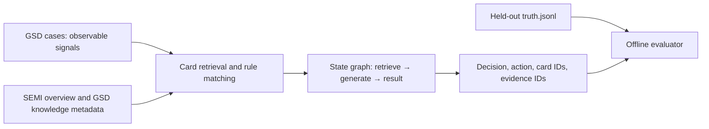

# Traceable GSD agent infrastructure: technical survey and experiment

Date: 2026-10-23. Scope: synthetic etch-tool triage, GSD generated cases, public standard semantics, and a Go agent template. The research baseline is documented in [TRACEABLE_AGENT_SURVEY](../generator/docs/TRACEABLE_AGENT_SURVEY.md); this project supplies an executable client and validation path.

## Research findings and boundary

SEMI E30/GEM and its related information/control standards supply equipment and process communication semantics. Public SEMI overviews do **not** supply the alarm codes, numeric limits, fault-to-action rules, or vendor repair SOPs required for a real fab deployment ([SEMI information and control](https://www.semi.org/en/products-services/standards/information_and_control)). The repository's [knowledge cards](../generator/agent/knowledge.json) are generator-linked hypotheses. Their `basis` is `generator_hypothesis`; the cards must never be presented as SEMI prescriptions. A response should trace observed signal IDs → matched card → source claim → suggested diagnostic check. Recipe and site-specific limits require authorized internal evidence.

The reference [agent-client-template](https://github.com/Disesfgewu/agent-client-template) is a Python client with multi-provider routing, skills retrieval, file handling, iterative chat, context compression, and optional actions. This Go package implements the reusable model client, evidence retrieval, state graph, tool injection, and legacy benchmark adapter. File extraction, vector embeddings, context compression, browser/code execution, and long-running session persistence are not yet implemented. Those functions remain extension points; no equivalence claim is made.

[LangGraph's Graph API](https://docs.langchain.com/oss/python/langgraph/graph-api) defines state, nodes, edges, conditional routing, reducers, and compilation. The Go `graph` package implements named nodes, fixed/conditional edges, bounded loops, state patches, compile-time target checks, execution traces, and `RunCheckpointed` resume after the last committed node. A node's top-level patch is committed only after it returns successfully. The input state is copied at the top level; callers should treat nested values as immutable. Parallel supersteps, reducers, interruptions, and LangGraph checkpoint wire compatibility are outside this implementation. The [Python bridge](examples/langgraph_node.py) wraps a built Go binary as an ordinary LangGraph node; this is interoperability, not a native LangGraph Go runtime. The included checkpoint store is in memory and is not durable across process restarts ([LangGraph persistence semantics](https://docs.langchain.com/oss/python/langgraph/persistence)).

## Provider and reasoning matrix

| Protocol | Endpoint from configured base | Reasoning mode configuration | Response extraction |
|---|---|---|---|
| `openai_responses` | `/responses` | `openai_effort` → `reasoning.effort` | output text parts |
| `openai_chat` | `/chat/completions` | none | `choices[].message.content` |
| `nim` | `/chat/completions` | model-specific `nim_enable_thinking` | content and optional `reasoning_content` |
| `google` | `/models/{model}:generateContent` | `google_level` or `google_budget` | candidate parts |
| `anthropic` | `/v1/messages` | `anthropic_adaptive` or legacy `anthropic_budget` | text and optional thinking blocks |
| `ollama` | `/api/chat` | `ollama_think` | content and optional thinking field |

Reasoning capability is **declared in each model configuration**; provider identity alone is insufficient. For example, Anthropic adaptive thinking applies to compatible Claude versions, while older models may use budget tokens; the NIM option is supported only by NIM models that expose it. The `Reasoning` request is omitted when blank. These mappings follow [OpenAI reasoning](https://developers.openai.com/api/docs/guides/reasoning), [Google thinking](https://ai.google.dev/gemini-api/docs/thinking), [Anthropic extended thinking](https://platform.claude.com/docs/en/build-with-claude/extended-thinking), [Ollama API](https://github.com/ollama/ollama/blob/main/docs/api.md), and [NVIDIA NIM LLM APIs](https://docs.api.nvidia.com/nim/reference/llm-apis). Configure a model's actual capability before enabling a mode. HTTP mock tests verify request paths, encoding, and response parsing; they do not prove a selected live model accepts the configured mode.

## Data and decision flow



The `gsd` package reads `cases.jsonl` and `knowledge.json` for inference. The scorer alone reads `truth.jsonl`. The deterministic baseline selects a card only when all required signals are present, forbidden signals absent, and there is one highest-specificity match. Otherwise it abstains with `insufficient_evidence` and `request_additional_measurement`. This makes conflicting evidence explicit. `agent.NewGSDRetriever` indexes card content and source claims, never the truth file. Markdown retrieval preserves source path, line span, and a short content hash. It uses token overlap, so domain synonyms and multilingual retrieval remain a limitation.

The model can explain or propose a diagnostic tool call, but the host must validate the chosen tool against a registered `agent.Tool` and any site SOP before execution. `RunTool` dispatches only registered tools. `Template.Triage` applies GSD cards to observable signals and never opens truth labels. The state graph returns committed patches and a trace; a failing node leaves its patch uncommitted. This is a result transaction at the node boundary, not a database transaction or equipment command transaction. The `Ask` graph also checks whether a returned answer mentions at least one retrieved document ID and exposes `citation_ids` and `citation_valid` in the result. This is a string-level citation check, not an entailment check.

`agent.Template` creates a protected `log/{agentName}_{YYYY-MM-DD-HH-MM-SS}.log` automatically on first use. Its `[DEBUG]` records include agent name, called function, serialized input and output, provider token usage or `?`, response time, and system timestamp. Known secret-key field names are redacted recursively; upstream HTTP error bodies are withheld. Free-text prompts and outputs are logged, as requested, so production deployments must protect the log directory and define retention/access policy. Concurrent writes use a mutex and file permissions are `0600` where supported. The CLI accepts `-agent-name` and `-log-dir`.

## Reproducible experiments

Environment: Windows PowerShell, Go 1.27.1, no external Go dependencies. Commands from `agent-template-client/`:

```powershell
go test ./...
go run ./cmd/agentctl benchmark
```

The tests cover conditional routing and failure rollback, checkpoint resume, loop bound, model-router fallback, six protocol adapters against local HTTP mock servers, unsupported reasoning rejection, automatic logging and redaction, and the seed42 legacy regression. The benchmark output was:

| Metric | Count |
|---|---:|
| Cases | 160 |
| Correct decisions | 160 |
| Correct actions | 160 |
| Valid card/source citations | 140 |
| Non-abstained cases | 140 |
| Schema-valid predictions | 160 |

The 20 remaining cases intentionally abstain, so they have no card citations. These scores measure deterministic rule compatibility with the generator-authored validation set. They are not live LLM scores or evidence of real fab fault accuracy. The test data and the card rules share a generator origin, so this is an in-distribution regression test. A meaningful next experiment uses unseen generator seeds, masked signals, and the existing Parquet adapter; score an LLM under the same held-out evaluator and compare abstention, action accuracy, citation validity, and latency.

### Live provider observations

The supplied local `.env` contained a configured NVIDIA NIM credential and model; the other provider model/key fields were empty. No credential value was copied into the report. The configured model was `minimaxai/minimax-m3.1-flash`. Live `chat` returned `OK`; `-reasoning on` returned `OK` plus a reasoning field. Live `ask` retrieved `K-VALVE` for `pressure_high` with `valve_position_mismatch` and returned `inspect_valve_position_trace` with the card and `gsd_rules` cited. The `etch-research` call created a timestamped log file with reported input/output token counts and response time. These are connectivity and integration observations, not a reliability estimate.

In the first two-case live LLM evaluation, the model selected both correct diagnostic actions but wrote `decision: "matched"` for `CASE-00000` instead of the card fault `valve_stick`; `CASE-00001` used the correct `sensor_ramp`. The measured score was 1/2 correct decisions, 2/2 correct actions, and 1/2 valid citations under the strict decision/card/action validator.

A throttled eight-case attempt (`-delay 10s`) produced seven predictions before NIM returned HTTP 429 on case eight. Completed predictions were saved locally under ignored `.agent-artifacts/`; only those seven were scored with `evaluate -limit 7`.

| Metric | Correct / 7 |
|---|---:|
| Decision | 2 |
| Action | 7 |
| Valid matched-card citation | 1 |
| Schema valid | 2 |
| Non-abstained | 6 |

Five responses used labels such as `match`, `matched`, or `unique_card_match` instead of the required fault name. The model often inferred the right diagnostic action but failed the output contract. This is a small, ordered, same-generator sample and does not establish a general accuracy rate. It demonstrates a concrete integration risk: a downstream tool must use `Template.Triage` or equivalent deterministic validation to decide whether an action is admissible. A longer live study needs provider quota planning and a larger held-out dataset; HTTP 429 was treated as a stopped experiment, not a fabricated eighth result.

## Deployment and research next steps

1. Load authorized internal alarm dictionaries, MES/FDC events, calibration records, and SOPs as versioned evidence with ownership and access controls.
2. Add a schema validator for observation units, time windows, tool/recipe applicability, and `source_id` before any diagnostic action is presented.
3. Evaluate with held-out tools and faults, not only held-out generated rows. Compare deterministic, LLM-only, and RAG plus rule variants under the same truth-isolated scorer.
4. Add durable checkpoint storage, retries with idempotency, observability, and provider rate-limit handling before production workflow use.

Until those steps are complete, this package is a research infrastructure prototype. No output should directly change equipment state.
