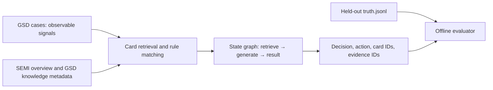

# Traceable GSD agent infrastructure: technical survey and experiment

Date: 2026-10-23. Scope: synthetic etch-tool triage, GSD generated cases, public standard semantics, and a Go agent template. The research baseline is documented in [TRACEABLE_AGENT_SURVEY](../generator/docs/TRACEABLE_AGENT_SURVEY.md); this project supplies an executable client and validation path.

## Research findings and boundary

SEMI E30/GEM and its related information/control standards supply equipment and process communication semantics. Public SEMI overviews do **not** supply the alarm codes, numeric limits, fault-to-action rules, or vendor repair SOPs required for a real fab deployment ([SEMI information and control](https://www.semi.org/en/products-services/standards/information_and_control)). The repository's [knowledge cards](../generator/agent/knowledge.json) are generator-linked hypotheses. Their `basis` is `generator_hypothesis`; the cards must never be presented as SEMI prescriptions. A response should trace observed signal IDs → matched card → source claim → suggested diagnostic check. Recipe and site-specific limits require authorized internal evidence.

The reference [agent-client-template](https://github.com/Disesfgewu/agent-client-template) is a Python client with multi-provider routing, skills retrieval, file handling, iterative chat, context compression, and optional actions. This Go package implements the reusable model client, evidence retrieval, state graph, tool injection, and legacy benchmark adapter. File extraction, vector embeddings, context compression, browser/code execution, and long-running session persistence are not yet implemented. Those functions remain extension points; no equivalence claim is made.

[LangGraph's Graph API](https://docs.langchain.com/oss/python/langgraph/graph-api) defines state, nodes, edges, conditional routing, reducers, and compilation. The Go `graph` package implements named nodes, fixed/conditional edges, bounded loops, state patches, compile-time target checks, execution traces, and `RunCheckpointed` resume after the last committed node. A node's top-level patch is committed only after it returns successfully. The input state is copied at the top level; callers should treat nested values as immutable. Parallel supersteps, reducers, interruptions, and LangGraph checkpoint wire compatibility are outside this implementation. The [Python bridge](examples/langgraph_node.py) wraps a built Go binary as an ordinary LangGraph node; this is interoperability, not a native LangGraph Go runtime. The included checkpoint store is in memory and is not durable across process restarts ([LangGraph persistence semantics](https://docs.langchain.com/oss/python/langgraph/persistence)).

## Provider and reasoning matrix

| Protocol | Endpoint from configured base | Reasoning mode configuration | Response extraction |
|---|---|---|---|
| `openai_responses` | `/responses` | `openai_effort` → `reasoning.effort` | output text parts |
| `openai_chat` | `/chat/completions` | none | `choices[].message.content` |
| `nim` | `/chat/completions` | model-specific `nim_enable_thinking` | content and optional `reasoning_content` |
| `google` | `/models/{model}:generateContent` | `google_level` or `google_budget` | candidate parts |
| `anthropic` | `/v1/messages` | `anthropic_adaptive` or legacy `anthropic_budget` | text and optional thinking blocks |
| `ollama` | `/api/chat` | `ollama_think` | content and optional thinking field |

Reasoning capability is **declared in each model configuration**; provider identity alone is insufficient. For example, Anthropic adaptive thinking applies to compatible Claude versions, while older models may use budget tokens; the NIM option is supported only by NIM models that expose it. The `Reasoning` request is omitted when blank. These mappings follow [OpenAI reasoning](https://developers.openai.com/api/docs/guides/reasoning), [Google thinking](https://ai.google.dev/gemini-api/docs/thinking), [Anthropic extended thinking](https://platform.claude.com/docs/en/build-with-claude/extended-thinking), [Ollama API](https://github.com/ollama/ollama/blob/main/docs/api.md), and [NVIDIA NIM LLM APIs](https://docs.api.nvidia.com/nim/reference/llm-apis). Configure a model's actual capability before enabling a mode. HTTP mock tests verify request paths, encoding, and response parsing; they do not prove a selected live model accepts the configured mode.

## Dataset preview and field dictionary

The committed seed42 diagnostic dataset contains 160 JSONL cases (`repeats_per_class: 20`). Each line is one independent synthetic etch-tool triage case. The manifest fixes seed, generator-spec hash, and knowledge hash so a run can verify which rule version produced it. Labels are constructed from GSD fault families; they are not observed fab failures.

### Observable case: `cases.jsonl`

This is the input that an Agent may read. A formatted version of the first record is:

```json
{
  "case_id": "CASE-00000",
  "context": {
    "event_protocol": "GEM-like JSON abstraction",
    "recipe_step": "main_etch"
  },
  "equipment_type": "synthetic_plasma_etcher",
  "signals": [
    "carrier_id_known",
    "valve_position_mismatch",
    "pressure_high"
  ],
  "source": {
    "kind": "GSD-spec-linked rule vignette",
    "seed": 42,
    "spec_sha256": "7f3535185416fb6f03dadb86cf1ade00f30c841f203c2f91e804b2edc1183ec5"
  },
  "tool_id": "ETCH-002"
}
```

| Field | Type | Meaning and use |
|---|---|---|
| `case_id` | string | Stable join key across case, prediction, and held-out truth. It is an example ID, not an equipment event ID. |
| `context.event_protocol` | string | Declares that this record uses a GEM-like JSON abstraction. It does not claim that the signal names are official GEM alarm IDs. |
| `context.recipe_step` | string | Process phase in which the observations apply; cards may be recipe-step sensitive. |
| `equipment_type` | string | Synthetic equipment family. It prevents silently applying an etcher card to another equipment class. |
| `signals` | string array | Observable categorical facts supplied to rule matching or the LLM. These contain no ground-truth fault label. |
| `source.kind` | string | How the case was constructed. Here it identifies a spec-linked synthetic vignette. |
| `source.seed` | integer | Reproduction seed for generated cases. |
| `source.spec_sha256` | string | Exact GSD rule-spec fingerprint used to create the case. This guards against comparing cases from different rule versions. |
| `tool_id` | string | Synthetic tool identifier used for tool-level grouping and held-out-tool experiments. It is not a real fab asset ID. |

`masked_cases.jsonl` has the same schema but deliberately removes a decisive signal. Its corresponding expected result is usually `insufficient_evidence`, which tests whether the Agent abstains instead of guessing.

### Knowledge card: `knowledge.json`

Knowledge is supplied separately from observations. One card looks like:

```json
{
  "id": "K-VALVE",
  "fault": "valve_stick",
  "required": ["pressure_high", "valve_position_mismatch"],
  "action": "inspect_valve_position_trace",
  "checks": [
    "Compare commanded and actual valve positions",
    "Review chamber pressure trend and recipe step"
  ],
  "evidence": ["gsd_rules"],
  "basis": "generator_hypothesis"
}
```

| Field | Type | Meaning and use |
|---|---|---|
| `schema_version` | string | Version of the overall knowledge-file schema. |
| `scope` | string | Safety and applicability statement for all cards in the file. |
| `sources` | map | Evidence registry keyed by source ID. Each entry contains `kind`, `uri`, and the limited `claim` supported by that source. |
| `cards[].id` | string | Stable citation ID returned in `card_ids`. |
| `cards[].fault` | string | Allowed structured diagnosis when the card uniquely matches. |
| `cards[].required` | string array | Every listed signal must occur in the observable case. |
| `cards[].forbidden` | string array, optional | The card is rejected if any listed signal occurs. |
| `cards[].action` | string | Allowed next diagnostic action. It is a synthetic benchmark suggestion, not a maintenance command. |
| `cards[].checks` | string array | Human-readable inspections supporting the action. |
| `cards[].evidence` | string array | IDs that must resolve in the top-level `sources` registry. |
| `cards[].basis` | string | Provenance class. `generator_hypothesis` prevents presenting the rule as an equipment-vendor or SEMI requirement. |

### Agent output: predictions JSONL

The deterministic baseline and an LLM must use the same output contract:

```json
{
  "case_id": "CASE-00000",
  "decision": "valve_stick",
  "action": "inspect_valve_position_trace",
  "card_ids": ["K-VALVE"],
  "evidence_ids": ["gsd_rules"],
  "observation_ids": [],
  "reason": "Matched observed signals: pressure_high, valve_position_mismatch"
}
```

| Field | Type | Validation rule |
|---|---|---|
| `case_id` | string | Must equal an input case ID exactly. |
| `decision` | string | Must be a card fault or `insufficient_evidence`; words such as `matched` are schema errors. |
| `action` | string | Must equal the selected card action or `request_additional_measurement` for abstention. |
| `card_ids` | string array | Identifies the exact card used. Empty for abstention. |
| `evidence_ids` | string array | Must resolve to evidence attached to the selected card, not merely any known source. |
| `observation_ids` | string array | References measured channels/threshold observations for Parquet-derived cases. Synthetic vignettes have no numeric observation records, so this is empty. |
| `reason` | string | Human-readable explanation retained for audit. It is required but not used as a substitute for structured validation. |

### Held-out answer: `truth.jsonl`

```json
{
  "action": "inspect_valve_position_trace",
  "case_id": "CASE-00000",
  "fault": "valve_stick",
  "scenario_card": "K-VALVE"
}
```

| Field | Type | Meaning |
|---|---|---|
| `case_id` | string | Join key for offline scoring. |
| `fault` | string | Generator-authored expected class. |
| `action` | string | Generator-authored expected diagnostic action. |
| `scenario_card` | string, optional | Card used to construct a positive case; absent for intentional insufficient-evidence cases. |

`truth.jsonl` must never enter retrieval, prompts, `Template.Triage`, or model context. Only `benchmark`, `evaluate`, and `llm-eval` read it after predictions exist. The audit log therefore shows when truth is opened and makes accidental leakage reviewable.

### Upstream GSD Parquet layers

The JSONL cases are the compact Agent-facing layer. The generator can also produce the following wafer/process layers:

| File | Row granularity | Visible to Agent? | Main contents |
|---|---|---:|---|
| `features.parquet` | one row per wafer | yes, through the adapter | Observable context such as `wafers_since_pm`, engineering flag, and aggregated process features. |
| `feature_names.json` | dataset-level mapping | yes | Stable mapping between feature indices/names and measured channels. |
| `events.parquet` | one row per generated event | after an event adapter is added | Fault onset and maintenance/event timeline. The current Go template does not ingest this directly. |
| `raw/<split>/frames.parquet` | one row per sampled frame | selectively | High-volume time series for trace or waveform tools. |
| `truth.parquet` | one row per wafer | evaluator only | Hidden fault ID/type/family, latent states, event counters, and future-event distances. |

The observable Parquet adapter fits thresholds only on the train split, then emits test-side signal flags plus channel, measured value, fitted threshold, source file, and calibration split. Truth remains in a separate scorer. This separation is the required pattern when replacing synthetic fields with real MES, FDC, SPC, or maintenance data.

## Data and decision flow



The `gsd` package reads `cases.jsonl` and `knowledge.json` for inference. The scorer alone reads `truth.jsonl`. The deterministic baseline selects a card only when all required signals are present, forbidden signals absent, and there is one highest-specificity match. Otherwise it abstains with `insufficient_evidence` and `request_additional_measurement`. This makes conflicting evidence explicit. `agent.NewGSDRetriever` indexes card content and source claims, never the truth file. Markdown retrieval preserves source path, line span, and a short content hash. It uses token overlap, so domain synonyms and multilingual retrieval remain a limitation.

The model can explain or propose a diagnostic tool call, but the host must validate the chosen tool against a registered `agent.Tool` and any site SOP before execution. `RunTool` dispatches only registered tools. `Template.Triage` applies GSD cards to observable signals and never opens truth labels. `Template.SystemPrompt` is the first-class prompt shared by `Ask` and `Chat`; `BuildMessages` prepends it and records the effective prompt. `Ask` also appends the evidence/citation contract and retrieved context. The state graph returns committed patches and a trace; a failing node leaves its patch uncommitted. This is a result transaction at the node boundary, not a database transaction or equipment command transaction. The `Ask` graph also checks whether a returned answer mentions at least one retrieved document ID and exposes `citation_ids` and `citation_valid` in the result. This is a string-level citation check, not an entailment check.

One protected `log/{agentName}_{start timestamp}.log` is used for the complete agent session. The recorder is propagated through `context.Context`; framework functions emit paired `START` and `END` records, including graph setup, nodes, routing, checkpoints, retrieval, tokenization, provider routing, HTTP encoding/parsing, GSD rules/evaluation, hooks, and tool boundaries. Each record contains a monotonic sequence, call and parent-call IDs, serialized input/output, provider token usage or `?`, elapsed time, and system timestamp. This supports reconstruction of one long nested execution trace rather than a summary at the agent entry point.

Records include `prev_hash` and a SHA-256 `hash`, are serialized behind a mutex, and are synced after each write. `agentctl audit-verify -log <path>` checks sequence continuity and the retained hash chain. This detects edits, reordering, and internal deletion; detecting tail truncation requires anchoring the final hash in a separate signed or append-only system. File creation is exclusive and uses nanosecond timestamps to prevent concurrent sessions from sharing a path. Permissions are `0600` where supported.

Known secret-key fields are recursively redacted and upstream HTTP error bodies are withheld. Free-text prompts, retrieved evidence, tool inputs, and outputs remain in the audit record, as requested, so production deployments must protect the directory and define retention/access policy. Go has no runtime interception for arbitrary external functions: all functions in this framework's operational call tree are instrumented, registered tool boundaries are automatic, and extension internals use `agentlog.Call`. Logger serialization/redaction/write helpers cannot self-log without recursion and are the explicit infrastructure exception.

## Reproducible experiments

Environment: Windows PowerShell, Go 1.27.1, no external Go dependencies. Commands from `agent-template-client/`:

```powershell
go test ./...
go run ./cmd/agentctl benchmark
```

The tests cover conditional routing and failure rollback, checkpoint resume, loop bound, model-router fallback, six protocol adapters against local HTTP mock servers, unsupported reasoning rejection, nested automatic audit logging, secret redaction, hash-chain verification, and the seed42 legacy regression. A full audited benchmark emitted 970 valid chained records in one 881,541-byte file. The benchmark output was:

| Metric | Count |
|---|---:|
| Cases | 160 |
| Correct decisions | 160 |
| Correct actions | 160 |
| Valid card/source citations | 140 |
| Non-abstained cases | 140 |
| Schema-valid predictions | 160 |

The 20 remaining cases intentionally abstain, so they have no card citations. These scores measure deterministic rule compatibility with the generator-authored validation set. They are not live LLM scores or evidence of real fab fault accuracy. The test data and the card rules share a generator origin, so this is an in-distribution regression test. A meaningful next experiment uses unseen generator seeds, masked signals, and the existing Parquet adapter; score an LLM under the same held-out evaluator and compare abstention, action accuracy, citation validity, and latency.

### Live provider observations

The supplied local `.env` contained a configured NVIDIA NIM credential and model; the other provider model/key fields were empty. No credential value was copied into the report. The configured model was `minimaxai/minimax-m3.1-flash`. Live `chat` returned `OK`; `-reasoning on` returned `OK` plus a reasoning field. Live `ask` retrieved `K-VALVE` for `pressure_high` with `valve_position_mismatch` and returned `inspect_valve_position_trace` with the card and `gsd_rules` cited. The `etch-research` call created a timestamped log file with reported input/output token counts and response time. These are connectivity and integration observations, not a reliability estimate.

In the first two-case live LLM evaluation, the model selected both correct diagnostic actions but wrote `decision: "matched"` for `CASE-00000` instead of the card fault `valve_stick`; `CASE-00001` used the correct `sensor_ramp`. The measured score was 1/2 correct decisions, 2/2 correct actions, and 1/2 valid citations under the strict decision/card/action validator.

A throttled eight-case attempt (`-delay 10s`) produced seven predictions before NIM returned HTTP 429 on case eight. Completed predictions were saved locally under ignored `.agent-artifacts/`; only those seven were scored with `evaluate -limit 7`.

| Metric | Correct / 7 |
|---|---:|
| Decision | 2 |
| Action | 7 |
| Valid matched-card citation | 1 |
| Schema valid | 2 |
| Non-abstained | 6 |

Five responses used labels such as `match`, `matched`, or `unique_card_match` instead of the required fault name. The model often inferred the right diagnostic action but failed the output contract. This is a small, ordered, same-generator sample and does not establish a general accuracy rate. It demonstrates a concrete integration risk: a downstream tool must use `Template.Triage` or equivalent deterministic validation to decide whether an action is admissible. A longer live study needs provider quota planning and a larger held-out dataset; HTTP 429 was treated as a stopped experiment, not a fabricated eighth result.

## Deployment and research next steps

1. Load authorized internal alarm dictionaries, MES/FDC events, calibration records, and SOPs as versioned evidence with ownership and access controls.
2. Add a schema validator for observation units, time windows, tool/recipe applicability, and `source_id` before any diagnostic action is presented.
3. Evaluate with held-out tools and faults, not only held-out generated rows. Compare deterministic, LLM-only, and RAG plus rule variants under the same truth-isolated scorer.
4. Add durable checkpoint storage, retries with idempotency, observability, and provider rate-limit handling before production workflow use.

Until those steps are complete, this package is a research infrastructure prototype. No output should directly change equipment state.
